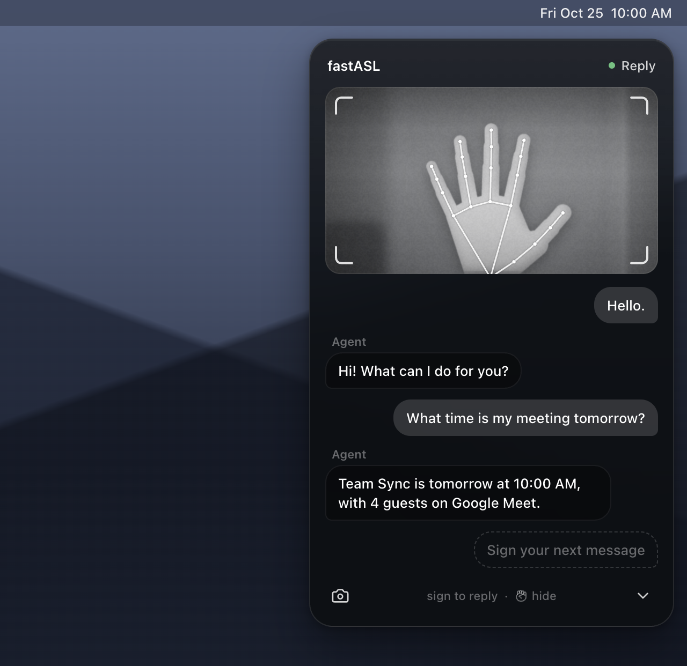
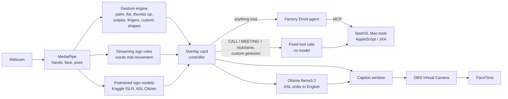

# fastASL

**Run your Mac in American Sign Language.** fastASL is an always-on overlay that reads signs from your webcam, turns them into actions (email, calendar, FaceTime, apps), and captions what you sign straight into the video your FaceTime caller sees.

<p align="center"></p>

Built at Cal Hacks. macOS only.

## What it does

- **Always-on overlay.** A small card floats over every app with a live camera view and a chat. Click ⌄ to hide it; hold an open palm up to bring it back.
- **Signs stream into sentences.** Each word appears as soon as its sign lands (TOMORROW, MEETING, WHAT, TIME...). Lower your hands to send the sentence.
- **Signs become actions.** A [Factory Droid](https://factory.ai) agent reads the signed sentence and uses real Mac tools: Calendar, Mail, Messages, Contacts, Notes, Spotify, FaceTime, apps, web search, screenshots.
- **Nothing sends without you.** Anything that sends, creates or calls shows a Confirm card first. A thumbs up runs it, a fist cancels.
- **Live captions on FaceTime.** What you sign is captioned into the video your caller receives, rewritten from ASL word order into English: `TOMORROW MEETING WHAT TIME` becomes "What time is the meeting tomorrow?".
- **Sign commands with no model in the loop:**
  - `CALL FRIEND` starts a FaceTime call to that contact after one confirmation, pressing Call for you.
  - `MEETING FRIEND`, then 1–4 fingers for 1–4 PM: Mail and Calendar open side by side, the invite and an email go out, and both apps show what was sent.
  - Contacts can also be named by fingerspelled initials (`CALL D W`).
- **Custom gestures.** Record any hand shape and bind it to a task. The built-in suggestion opens six Claude Code terminals tiled across the screen.

## How it works



| Layer | What it uses |
| --- | --- |
| App | Electron 39, electron-vite, React 19, TypeScript. A transparent, always-on-top overlay window plus a 1280×720 caption window. |
| Tracking | Google MediaPipe Tasks Vision: Hand Landmarker (2 hands) every frame, Face and Pose Landmarkers on alternating frames, on the GPU at ~30 fps. The signer is the closest person in view. |
| Streaming signs | Our rules over the landmarks (handshape, location against the face, movement): a dictionary (HELLO, MEETING) and per-word rules (TOMORROW, CALL, THANK YOU, MOM, DAD, YES, NO, TIME, EMAIL, PLAY, WHAT, OPEN, PLEASE, FRIEND), plus sequence rules for signs that pass through each other (FRIEND over TIME). |
| Pretrained models | The 1st-place model of Google's Kaggle *Isolated Sign Language Recognition* competition, ported to ONNX (11 MB, fp16) and run with onnxruntime-web in a worker. Optionally Microsoft's *ASL Citizen* pose model (ST-GCN) for more words. |
| Agent | Factory Droid SDK with one persistent session. Droid's own tools are switched off; it gets 19 fastASL tools through an in-process MCP server. Writes go through a Confirm card. |
| Captions | The caption window (camera + captions) is captured by OBS and published as OBS Virtual Camera, which FaceTime uses as its camera. A local Ollama model (llama3.2) rewrites each phrase into English in 0.2–0.9 s; it is used only if every signed word is still in the sentence. |

The design decisions, with the numbers behind them, are in [DECISIONS.md](DECISIONS.md). Manual test scripts for every feature are in [TESTING.md](TESTING.md).

## Requirements

- A Mac with a camera. Developed and tested on an Apple Silicon MacBook running macOS 26.
- Node.js 20.19+ and npm.
- For actions: a [Factory](https://factory.ai) API key and the `droid` CLI (`brew install --cask droid`).
- For English captions: [Ollama](https://ollama.com) with `ollama pull llama3.2`.
- For captions on FaceTime: [OBS Studio](https://obsproject.com) 28+ (`brew install --cask obs`).

## Setup

```bash
git clone https://github.com/Yuvraajb/fastASL.git
cd fastASL
npm install                # also fetches MediaPipe and onnxruntime assets (npm run setup)
cp .env.example .env       # then fill in FACTORY_API_KEY at least
npm run setup:citizen      # optional: Microsoft ASL Citizen weights (non-commercial, see Licences)
```

Key settings in `.env` (every key is optional; a feature without its key says so on the card):

| Variable | What it does |
| --- | --- |
| `FACTORY_API_KEY` | The Droid agent that performs actions. |
| `LLM_PROVIDER` | `droid` (signs go straight to the agent; the demo setting), `claude`, `gemini`, `local` (Ollama) or `mock`. |
| `ANTHROPIC_API_KEY`, `GEMINI_API_KEY` | For `LLM_PROVIDER=claude` / `gemini`. |
| `LOCAL_LLM_URL`, `LOCAL_LLM_MODEL` | Ollama for `local` and for the English captions (default `llama3.2`). |
| `FASTASL_CONTACT_ALIASES` | Signs or initials that name a contact, e.g. `friend=Jane Doe; jd=Jane Doe`. The full name must match Contacts. |
| `FASTASL_CLAUDE_DIR` | The folder the Claude Code gesture opens terminals in (default: home). |
| `OBS_WS_PASSWORD`, `OBS_WS_URL` | OBS WebSocket, for `npm run obs`. |
| `SPOTIFY_CLIENT_ID`, `SPOTIFY_CLIENT_SECRET` | Spotify search. |

The first time each feature runs, macOS asks for permissions. Allow them for fastASL (shown as *Electron* in development):

- Camera.
- Accessibility, to press FaceTime's Call button and type text.
- Automation for Calendar, Mail, Messages, Contacts, Notes, FaceTime, Terminal and System Events.
- For OBS: Screen Recording, and its camera extension under System Settings › General › Login Items & Extensions.

## Run

```bash
npm run dev            # the overlay
npm run dev:captions   # the overlay plus the caption window, for FaceTime
npm run obs            # once: point OBS at the caption window and start OBS Virtual Camera
npm run obs -- --repoint   # after each restart of fastASL (the caption window is new)
```

Then in FaceTime choose **Video › OBS Virtual Camera**. Your own preview is mirrored; the caller sees the captions the right way round.

## Using it

Signing happens in **Command mode** (the default). Lower your hands to send what you signed.

| Gesture | Does |
| --- | --- |
| Open palm, held still | Wake the hidden card |
| Thumbs up | Quick menu in Ready; send the sentence; allow a Confirm card |
| Fist | Cancel the sentence, decline a Confirm card, stop the agent |
| Swipe left | Delete the last word |
| Swipe right | Send now, or switch mode from Ready |
| Swipe up | Settings (or click the gear) |
| 1–5 fingers | Pick an option in a list |
| Hands down for 2.5 s | Send the sentence |
| Your own shape | Run its task (Settings › New gesture) |

The **captions button** in the card's footer switches the caption window on and off. On: what you sign becomes captions for the call (CALL and MEETING still act). Off: it goes to the agent and the captions go blank.

Things to sign:

- `HELLO`, `THANK YOU`, `YES`, `NO`. With captions on, `TOMORROW MEETING WHAT TIME` is captioned as "What time is the meeting tomorrow?".
- `CALL FRIEND` (or `CALL D W`) to call a contact named in `FASTASL_CONTACT_ALIASES`.
- `MEETING FRIEND` (or `TOMORROW MEETING FRIEND`), then 1–4 fingers for the time.
- Anything else goes to the agent, e.g. `TOMORROW MEETING WHAT TIME` with captions off reads your calendar.

The initials D and W work with no teaching right after CALL or MEETING. Any other sign or letter can be taught in Settings › Teach a sign.

## Project layout

```
src/
  main/                  Electron main process
    agent/               Droid session, permission gate, direct commands, shortcuts
    tools/               the Mac tools the agent may call (one file per app)
    mac/                 AppleScript / JXA helpers
    llm/                 LLM providers and the caption translator
    captionWindow.ts     the caption camera window
  preload/               the window.fastasl bridge
  shared/                types, IPC channels, the sign dictionary
  renderer/src/
    app/                 controller (card states), phrase and view rules, engines wiring
    engine/camera/       camera pipeline and MediaPipe tracker
    engine/gestures/     control gestures and custom shapes
    engine/recognition/  streaming rules, lexicon, initials, teaching
    engine/model/        the pretrained sign models
    views/  ui/          the card's React views and components
    captions/            the caption camera page
scripts/                 asset setup, ASL Citizen, OBS, screenshots
docs/                    screenshots and research notes
```

## Development

```bash
npm test             # 1,300+ unit and integration tests (vitest)
npm run typecheck
npm run screens      # render every card state to docs/screens
npm run build
```

The real-data evaluations of the sign rules (`*.eval.test.ts`) are skipped unless `FASTASL_STREAM_DATA` points at clip folders; see DECISIONS.md for the numbers.

## Privacy

Camera frames stay on the Mac, except for sign guesses with `LLM_PROVIDER=claude` or `gemini` (a few frames of a sign nothing recognized). The agent receives the signed words and the tool results it asks for. English captions are written by a local model. Nothing that sends, creates, deletes or calls runs without a Confirm card, including steps inside a custom gesture's task.

## Licences and credits

- fastASL: MIT.
- Kaggle *Isolated Sign Language Recognition* 1st-place model: MIT (see `src/renderer/public/models/MODEL_LICENSE.md`).
- Microsoft *ASL Citizen*: non-commercial research use only, no redistribution. It is downloaded by `npm run setup:citizen`, never committed, and a build that includes it must not be shared.
- Google MediaPipe, onnxruntime-web, Factory Droid SDK, Ollama and llama3.2, OBS Studio.
